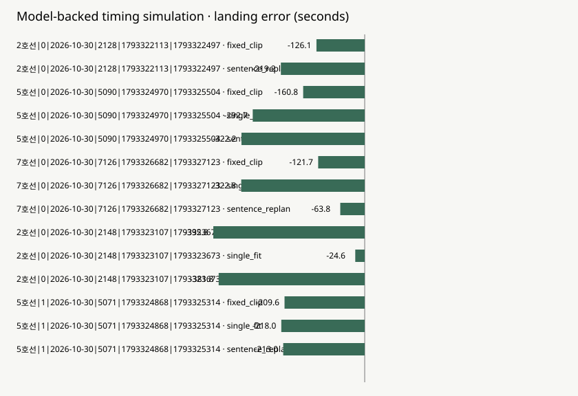

# Results

**Model-backed timing simulation.**

Model-generated text on recorded receipt-time arrival traces. Speech duration is simulated from fixed Unicode characters/second plus measured HTTP latency. Offline 45RPM/300000TPM pacing and public-price audit waits count in real runtime but are excluded from the simulated speech clock; this assumes no competing account traffic. No browser TTS, door-open, or real-world narration accuracy is measured.

Completed simulation runs: **16**. Inference dispatch attempts: **35**. Measured TTS runs: **0**. Status: **completed-with-model-failures**. Rows in this table: **14**. Usage/catalog cost estimate represented (all retained attempts): **$0.009085**.

Costs multiply retained provider usage by acknowledged public catalog rates; invoice/account billing is unverified. The header includes all retained attempts, including failed attempts with known costs; missing usage keeps the total UNKNOWN. Policy cost/story below uses scored rows only.

Paired coverage: **4 of 5 journeys** have all three policies. Unpaired journeys: **1**. Comparison basis: **mixed-paired-and-unpaired**.

The table below is descriptive. Policy groups contain unpaired journeys and must not be treated as a controlled same-journey comparison.

Coverage below contains completed timing simulations on recorded windows, not measured audio. EN/KO pair rows: 2. Failures/attempts remain in the source matrix.

## Scheduled evaluation coverage

Timing percentages and cost/story in the policy table use completed, scored rows only. Failed and unstarted slots remain in the planned denominator below and have no fabricated landing error. Visiting every slot does not mean every model output succeeded.

| Scope | Planned | Attempted | Scored | Failed (unscored) | Known model rejections | Fatal aborts | Unstarted |
|---|---:|---:|---:|---:|---:|---:|---:|
| Total | 17 | 17 | 16 | 1 | 1 | 0 | 0 |
| fixed_clip | 5 | 5 | 5 | 0 | 0 | 0 | 0 |
| single_fit | 5 | 5 | 4 | 1 | 1 | 0 | 0 |
| sentence_replan | 5 | 5 | 5 | 0 | 0 | 0 | 0 |
| EN/KO pair | 2 | 2 | 2 | 0 | 0 | 0 | 0 |
| EN pair | 1 | 1 | 1 | 0 | 0 | 0 | 0 |
| KO pair | 1 | 1 | 1 | 0 | 0 | 0 | 0 |

| Policy | n | ≤30 s | ≤10 s | Median absolute error | Cost/story | Median story call p50 | Median story call p95 |
|---|---:|---:|---:|---:|---:|---:|---:|
| fixed_clip | 5 | 0.0% | 0.0% | 160.8 s | $0.000406 | 3960.0 ms | 3960.0 ms |
| single_fit | 4 | 25.0% | 0.0% | 255.4 s | $0.000430 | 3867.5 ms | 3867.5 ms |
| sentence_replan | 5 | 0.0% | 0.0% | 219.2 s | $0.000703 | 621.0 ms | 3487.0 ms |

Latency summaries are medians of each story's call-latency quantile; they are not pooled call percentiles.

## English / Korean comparison

Both rows cover the same frozen journey `2호선\|0\|2026-10-30\|2128\|1793322113\|1793322497` and policy. This is a two-run descriptive comparison, not a language-quality score or independent evidence of door timing.

Speech timing uses the declared character-rate simulation; browser TTS remains unmeasured by this table.

| Language | Writer reported with matching identity | Landing error | Cost/story | Tokens | Call p50 | Call p95 |
|---|---|---:|---:|---:|---:|---:|
| en | Super | -183.2 s | $0.000712 | 7142 | 529.5 ms | 3342.0 ms |
| ko | Ultra | -354.3 s | $0.000743 | 2606 | 575.5 ms | 1006.0 ms |

| Language | Conductor completions | Writer attempts | Tool calls supported | Tavily result |
|---|---:|---:|---|---|
| en | 9 | 1 | true | not recorded |
| ko | 3 | 1 | true | not recorded |

Writer identities require explicit matching requested/provider-reported IDs in the receipts. Unknown provenance or cost is never converted to an expected model or zero spend. The original matrix retains full receipts and clock provenance.


Positive error means the story ended after the arrival proxy; negative means before it.



## Interpretation

Text comes from protected Worker model calls; speech duration is estimated from a fixed Unicode-character rate. Measured HTTP latency advances the simulation clock, and revisions take effect at sentence boundaries. Forecasts fit only other train identities. Only observed station timestamps reach the controller; final arrival is withheld for scoring. Offline request pacing and public-price audit waits count in real session runtime but are excluded from this speech simulation. This is not browser speech, forward-in-time ETA, semantic story-quality, or door-open validation.

A numerical comparison with the earlier handoff's simulation is unavailable: its uncertainty model and data were not reproduced here.

## Observed ETA proxy validation · 2호선

This section describes recorded station-arrival ETA validation. It is separate from the story-policy comparison above and does not measure Nemotron story generation, browser speech timing, or model-backed story landing accuracy.

| Recorded ETA measure | Value |
|---|---:|
| Eligible held-out forecast windows | 338 |
| Train identities represented by arrival chains | 9 |
| Median relative error | 4.9552% |
| Registered median error ≤15% gate | PASS |

Method: `leave-one-train-identity-out`. Status: `measured`. Forecast windows can overlap and reuse stations within a train identity; the window count is not a count of independent journeys or independent samples. The complete held-out train identity is excluded from fitting. No result here establishes performance on unobserved routes or operating periods.

Receipt timestamp age: **p50 50 s / p95 97 s** across **600 repeated polling records**. This is polled `ts` minus provider `recptnDt`: timestamp age, **not network lag, transport delay, or door-open offset**. Repeated polls are not independent journeys.

Trace snapshot: 600 observation records, 120 distinct polls, 0 gap records. Recording marked partial: `False`.

ETA and trace-quality artifacts reference the same trace snapshot, also matching the current local trace.

| Snapshot | SHA-256 |
|---|---|
| ETA artifact | `081db5eeb3a0273d0447869a693397b65e45e05f0fe60c528e772100891703e5` |
| Trace-quality artifact | `081db5eeb3a0273d0447869a693397b65e45e05f0fe60c528e772100891703e5` |
| Current local trace | `081db5eeb3a0273d0447869a693397b65e45e05f0fe60c528e772100891703e5` |

## Observed ETA proxy validation · 5호선

This section describes recorded station-arrival ETA validation. It is separate from the story-policy comparison above and does not measure Nemotron story generation, browser speech timing, or model-backed story landing accuracy.

| Recorded ETA measure | Value |
|---|---:|
| Eligible held-out forecast windows | 556 |
| Train identities represented by arrival chains | 5 |
| Median relative error | 1.9615% |
| Registered median error ≤15% gate | PASS |

Method: `leave-one-train-identity-out`. Status: `measured`. Forecast windows can overlap and reuse stations within a train identity; the window count is not a count of independent journeys or independent samples. The complete held-out train identity is excluded from fitting. No result here establishes performance on unobserved routes or operating periods.

Receipt timestamp age: **p50 69 s / p95 114 s** across **600 repeated polling records**. This is polled `ts` minus provider `recptnDt`: timestamp age, **not network lag, transport delay, or door-open offset**. Repeated polls are not independent journeys.

Trace snapshot: 600 observation records, 120 distinct polls, 0 gap records. Recording marked partial: `False`.

ETA and trace-quality artifacts reference the same trace snapshot, also matching the current local trace.

| Snapshot | SHA-256 |
|---|---|
| ETA artifact | `e3dab03721068af42f97bb065fafdcafc948dc9d8ae677f77fdfc529d4fac61d` |
| Trace-quality artifact | `e3dab03721068af42f97bb065fafdcafc948dc9d8ae677f77fdfc529d4fac61d` |
| Current local trace | `e3dab03721068af42f97bb065fafdcafc948dc9d8ae677f77fdfc529d4fac61d` |

## Observed ETA proxy validation · 7호선

This section describes recorded station-arrival ETA validation. It is separate from the story-policy comparison above and does not measure Nemotron story generation, browser speech timing, or model-backed story landing accuracy.

| Recorded ETA measure | Value |
|---|---:|
| Eligible held-out forecast windows | 279 |
| Train identities represented by arrival chains | 9 |
| Median relative error | 4.7619% |
| Registered median error ≤15% gate | PASS |

Method: `leave-one-train-identity-out`. Status: `measured`. Forecast windows can overlap and reuse stations within a train identity; the window count is not a count of independent journeys or independent samples. The complete held-out train identity is excluded from fitting. No result here establishes performance on unobserved routes or operating periods.

Receipt timestamp age: **p50 58 s / p95 211 s** across **600 repeated polling records**. This is polled `ts` minus provider `recptnDt`: timestamp age, **not network lag, transport delay, or door-open offset**. Repeated polls are not independent journeys.

Trace snapshot: 600 observation records, 120 distinct polls, 0 gap records. Recording marked partial: `False`.

ETA and trace-quality artifacts reference the same trace snapshot, also matching the current local trace.

| Snapshot | SHA-256 |
|---|---|
| ETA artifact | `4246a76974c33c3867e11c67fd68c4421c6f1946c68a0b7ea81afb60432505b4` |
| Trace-quality artifact | `4246a76974c33c3867e11c67fd68c4421c6f1946c68a0b7ea81afb60432505b4` |
| Current local trace | `4246a76974c33c3867e11c67fd68c4421c6f1946c68a0b7ea81afb60432505b4` |

Offline pacing: `45 RPM / 300000 TPM`, waited `57.128 s`, real runtime ceiling `4500.0 s`. Pacing reserves worst-case completion groups/input+output tokens and assumes no competing account traffic. These artificial experiment waits are excluded from simulated speech timing. Provider failures remain failures.

## Model execution failures

```json
[
  {
    "type": "ModelOutputRejection",
    "reason": "Worker rejected model output: writer_constraint_failure; receipts and cost retained",
    "scope": "slot",
    "slot_index": 1,
    "id": "2호선|0|2026-10-30|2128|1793322113|1793322497",
    "line": "2호선",
    "policy": "single_fit",
    "lang": "en",
    "group": "policy",
    "error_code": "writer_constraint_failure",
    "failed_attempt_index": 1,
    "scored": false,
    "retry_performed": false
  }
]
```

All attempted calls, including failures and unknown usage/cost, are retained in the source matrix's `attempts` array. An aborted run with incomplete receipts is never reported as zero spend.

## Five largest absolute errors

Largest errors among completed scored rows, retained verbatim. Unscored execution failures have no invented landing error; they remain in the separate failures/attempts records and model-failure section when applicable:

```json
[
  {
    "id": "2호선|0|2026-10-30|2148|1793323107|1793323673",
    "line": "2호선",
    "trainNo": "2148",
    "policy": "fixed_clip",
    "lang": "en",
    "exit_station": "이대",
    "evidence_kind": "model-backed-timing-simulation",
    "landing_error_s": -395.81633492266167,
    "story_end_s": 170.18366507733833,
    "arrival_proxy_s": 566.0,
    "initial_forecast_s": 577.0,
    "speech_clock": "fixed-unicode-character-rate-plus-measured-http-latency",
    "speech_rate_cps": 4.51,
    "conductor_calls": 0,
    "conductor_requests": 0,
    "writer_calls": 1,
    "tokens": 568,
    "cost_usd": 0.00029039999999999996,
    "p50_latency_ms": 3323,
    "p95_latency_ms": 3323,
    "tool_calls_supported": null,
    "tavily_ok": null,
    "fact_mode": "station-only-no-search-requested",
    "arrival_event": "station-arrival-proxy",
    "forecast_log": [],
    "controller_decisions": [],
    "receipts": [
      {
        "mode": "live",
        "sentences": [
          "The empty carriage smelled of rain and old paper.",
          "Faint footsteps echoed from somewhere ahead.",
          "No one appeared when I turned my head.",
          "My reflection blinked slower than I did.",
          "The window showed tunnels passing like thoughts.",
          "A folded note lay on the seat opposite.",
          "It read: “Trust the silence between stops.”",
          "Lights flickered once, then steadied.",
          "Outside, neon signs blurred into streaks.",
          "The train slowed without announcement.",
          "Doors hissed open at a ghost platform.",
          "No signs marked where we had stopped.",
          "I stepped onto wet tiles, alone.",
          "An announcer’s voice whispered my name.",
          "Then silence returned, deeper than before.",
          "The train departed without me aboard.",
          "I walked toward the faint glow of exit.",
          "This station was not on any map.",
          "Yet the sign above read clearly: 이대"
        ],
        "sentence_cap": 90,
        "fact_grounding": "station-only",
        "char_count": 748,
        "receipt_schema": "last-sentence/receipt-v2",
        "model": "nvidia/nemotron-3-super-120b-a12b",
        "requested_model": "nvidia/nemotron-3-super-120b-a12b",
        "provider_reported_model": "nvidia/nemotron-3-super-120b-a12b",
        "identity_match": true,
        "usage": {
          "prompt_tokens": 368,
          "completion_tokens": 200,
          "total_tokens": 568
        },
        "cost_usd": 0.00029039999999999996,
        "requested_rate_cost_estimate_usd": 0.00029039999999999996,
        "latency_ms": 3870,
        "calls": [
          {
            "receipt_schema": "last-sentence/receipt-v2",
            "model": "nvidia/nemotron-3-super-120b-a12b",
            "requested_model": "nvidia/nemotron-3-super-120b-a12b",
            "provider_reported_model": "nvidia/nemotron-3-super-120b-a12b",
            "identity_match": true,
            "usage": {
              "prompt_tokens": 368,
              "completion_tokens": 200,
              "total_tokens": 568
            },
            "cost_usd": 0.00029039999999999996,
            "requested_rate_cost_estimate_usd": 0.00029039999999999996,
            "latency_ms": 3323,
            "input_token_bound": 5865,
            "reserved_microusd": 2840,
            "pricing": {
              "input_price_per_million_tokens": 0.3,
              "output_price_per_million_tokens": 0.9,
              "source_url": "https://tokenfactory.nebius.com/api/public/models_info",
              "observed_at": "2026-10-30T15:30:57.312Z",
              "catalog_cache_ttl_s": 3600,
              "fresh_for_dispatch": true,
              "acknowledged": true
            },
            "rate_limit_headers": {
              "x-ratelimit-limit-requests": "1000",
              "x-ratelimit-remaining-requests": "999",
              "x-ratelimit-limit-tokens": "1000000",
              "x-ratelimit-remaining-tokens": "999097"
            },
            "writer_validation": {
              "status": "valid",
              "purpose": "story",
              "counting_basis": "trimmed-nonempty-lines/unicode-code-points",
              "language": "en",
              "text_response": true,
              "sentence_count": 19,
              "sentences_within_cap": 19,
              "sentences_over_cap": 0,
              "max_sentence_chars": 49,
              "total_chars": 748,
              "sentence_cap": 90,
              "max_sentence_count": 100,
              "required_sentence_count": null,
              "budget_chars": 2512,
              "scene_budget_ok": true,
              "sentence_count_ok": true,
              "sentence_lengths_ok": true,
              "ending_required": true,
              "ending_station_ok": true,
              "passed": true,
              "failures": []
            }
          }
        ]
      }
    ],
    "simulated_sentences": [
      {
        "start": 4.330006540752947,
        "end": 15.194751551839422,
        "text": "The empty carriage smelled of rain and old paper.",
        "scene_id": "scene-1",
        "kind": "body"
      },
      {
        "start": 15.194751551839422,
        "end": 24.950849112815032,
        "text": "Faint footsteps echoed from somewhere ahead.",
        "scene_id": "scene-1",
        "kind": "body"
      },
      {
        "start": 24.950849112815032,
        "end": 33.376569733657604,
        "text": "No one appeared when I turned my head.",
        "scene_id": "scene-1",
        "kind": "body"
      },
      {
        "start": 33.376569733657604,
        "end": 42.24574933454452,
        "text": "My reflection blinked slower than I did.",
        "scene_id": "scene-1",
        "kind": "body"
      },
      {
        "start": 42.24574933454452,
        "end": 52.88876485560883,
        "text": "The window showed tunnels passing like thoughts.",
        "scene_id": "scene-1",
        "kind": "body"
      },
      {
        "start": 52.88876485560883,
        "end": 61.53621496647357,
        "text": "A folded note lay on the seat opposite.",
        "scene_id": "scene-1",
        "kind": "body"
      },
      {
        "start": 61.53621496647357,
        "end": 71.07058303742701,
        "text": "It read: “Trust the silence between stops.”",
        "scene_id": "scene-1",
        "kind": "body"
      },
      {
        "start": 71.07058303742701,
        "end": 79.27457416824741,
        "text": "Lights flickered once, then steadied.",
        "scene_id": "scene-1",
        "kind": "body"
      },
      {
        "start": 79.27457416824741,
        "end": 88.3654832591565,
        "text": "Outside, neon signs blurred into streaks.",
        "scene_id": "scene-1",
        "kind": "body"
      },
      {
        "start": 88.3654832591565,
        "end": 96.79120387999907,
        "text": "The train slowed without announcement.",
        "scene_id": "scene-2",
        "kind": "body"
      },
      {
        "start": 96.79120387999907,
        "end": 105.21692450084164,
        "text": "Doors hissed open at a ghost platform.",
        "scene_id": "scene-2",
        "kind": "body"
      },
      {
        "start": 105.21692450084164,
        "end": 113.42091563166204,
        "text": "No signs marked where we had stopped.",
        "scene_id": "scene-2",
        "kind": "body"
      },
      {
        "start": 113.42091563166204,
        "end": 120.51625931237157,
        "text": "I stepped onto wet tiles, alone.",
        "scene_id": "scene-2",
        "kind": "body"
      },
      {
        "start": 120.51625931237157,
        "end": 129.16370942323633,
        "text": "An announcer’s voice whispered my name.",
        "scene_id": "scene-2",
        "kind": "body"
      },
      {
        "start": 129.16370942323633,
        "end": 138.4763480041676,
        "text": "Then silence returned, deeper than before.",
        "scene_id": "scene-2",
        "kind": "body"
      },
      {
        "start": 138.4763480041676,
        "end": 146.680339134988,
        "text": "The train departed without me aboard.",
        "scene_id": "scene-2",
        "kind": "body"
      },
      {
        "start": 146.680339134988,
        "end": 155.32778924585276,
        "text": "I walked toward the faint glow of exit.",
        "scene_id": "scene-2",
        "kind": "body"
      },
      {
        "start": 155.32778924585276,
        "end": 162.4231329265623,
        "text": "This station was not on any map.",
        "scene_id": "scene-2",
        "kind": "body"
      },
      {
        "start": 162.4231329265623,
        "end": 170.18366507733833,
        "text": "Yet the sign above read clearly: 이대",
        "scene_id": "exit",
        "kind": "exit"
      }
    ],
    "final_scene_state": [
      {
        "id": "scene-1",
        "kind": "body",
        "sentences": [
          "The empty carriage smelled of rain and old paper.",
          "Faint footsteps echoed from somewhere ahead.",
          "No one appeared when I turned my head.",
          "My reflection blinked slower than I did.",
          "The window showed tunnels passing like thoughts.",
          "A folded note lay on the seat opposite.",
          "It read: “Trust the silence between stops.”",
          "Lights flickered once, then steadied.",
          "Outside, neon signs blurred into streaks."
        ]
      },
      {
        "id": "scene-2",
        "kind": "body",
        "sentences": [
          "The train slowed without announcement.",
          "Doors hissed open at a ghost platform.",
          "No signs marked where we had stopped.",
          "I stepped onto wet tiles, alone.",
          "An announcer’s voice whispered my name.",
          "Then silence returned, deeper than before.",
          "The train departed without me aboard.",
          "I walked toward the faint glow of exit.",
          "This station was not on any map."
        ]
      },
      {
        "id": "exit",
        "kind": "exit",
        "sentences": [
          "Yet the sign above read clearly: 이대"
        ]
      }
    ],
    "scene_contract": "named scene-1/scene-2/exit; only wholly unstarted scenes editable; drop local, affected-scene insert/compress; four Writer attempts including initial"
  },
  {
    "id": "2호선|0|2026-10-30|2148|1793323107|1793323673",
    "line": "2호선",
    "trainNo": "2148",
    "policy": "sentence_replan",
    "lang": "en",
    "exit_station": "이대",
    "evidence_kind": "model-backed-timing-simulation",
    "landing_error_s": -381.7629525993585,
    "story_end_s": 184.2370474006415,
    "arrival_proxy_s": 566.0,
    "initial_forecast_s": 577.0,
    "speech_clock": "fixed-unicode-character-rate-plus-measured-http-latency",
    "speech_rate_cps": 4.51,
    "conductor_calls": 6,
    "conductor_requests": 2,
    "writer_calls": 1,
    "tokens": 4858,
    "cost_usd": 0.00057264,
    "p50_latency_ms": 621,
    "p95_latency_ms": 3487,
    "tool_calls_supported": true,
    "tavily_ok": null,
    "fact_mode": "station-only-no-search-requested",
    "arrival_event": "station-arrival-proxy",
    "forecast_log": [
      {
        "station": "당산",
        "observed_at_s": 0.0,
        "controller_clock_s": 0.0,
        "remaining_s": 577.0,
        "eta_source": "operator-estimate",
        "offline_provenance": "whole-train-held-out receipt-time ETA; not a server-verified live anchor"
      },
      {
        "station": "합정",
        "observed_at_s": 169.0,
        "controller_clock_s": 169.0,
        "remaining_s": 408.0,
        "eta_source": "operator-estimate",
        "offline_provenance": "whole-train-held-out receipt-time ETA; not a server-verified live anchor"
      }
    ],
    "controller_decisions": [
      {
        "station": "홍대입구",
        "action": "story-already-ended"
      }
    ],
    "receipts": [
      {
        "mode": "live",
        "plan": {
          "stations_left": 4,
          "remaining_s": 577,
          "budget_chars": 2512,
          "eta_source": "operator-estimate",
          "ops": [],
          "log": "No scene edits are needed."
        },
        "tool_calls_supported": true,
        "required_tools_completed": false,
        "tool_executions": [
          {
            "tool": "eta_to_station",
            "result": {
              "stations_left": 4,
              "remaining_s": 577,
              "eta_source": "operator-estimate"
            }
          },
          {
            "tool": "budget",
            "result": {
              "budget_chars": 2512,
              "speech_rate_cps": 4.51,
              "margin_s": 20
            }
          }
        ],
        "receipt_schema": "last-sentence/receipt-v2",
        "model": "nvidia/Nemotron-3_5-Lightning",
        "requested_model": "nvidia/Nemotron-3_5-Lightning",
        "provider_reported_model": "nvidia/Nemotron-3_5-Lightning",
        "identity_match": true,
        "usage": {
          "prompt_tokens": 2076,
          "completion_tokens": 48,
          "total_tokens": 2124
        },
        "cost_usd": 0.00013608,
        "requested_rate_cost_estimate_usd": 0.00013608,
        "latency_ms": 3899,
        "calls": [
          {
            "receipt_schema": "last-sentence/receipt-v2",
            "model": "nvidia/Nemotron-3_5-Lightning",
            "requested_model": "nvidia/Nemotron-3_5-Lightning",
            "provider_reported_model": "nvidia/Nemotron-3_5-Lightning",
            "identity_match": true,
            "usage": {
              "prompt_tokens": 793,
              "completion_tokens": 17,
              "total_tokens": 810
            },
            "cost_usd": 5.166e-05,
            "requested_rate_cost_estimate_usd": 5.166e-05,
            "latency_ms": 829,
            "input_token_bound": 5913,
            "reserved_microusd": 451,
            "pricing": {
              "input_price_per_million_tokens": 0.06,
              "output_price_per_million_tokens": 0.24,
              "source_url": "https://tokenfactory.nebius.com/api/public/models_info",
              "observed_at": "2026-10-30T15:31:15.379Z",
              "catalog_cache_ttl_s": 3600,
              "fresh_for_dispatch": true,
              "acknowledged": true
            },
            "rate_limit_headers": {
              "x-ratelimit-limit-requests": "1000",
              "x-ratelimit-remaining-requests": "999",
              "x-ratelimit-limit-tokens": "2000000",
              "x-ratelimit-remaining-tokens": "1999207"
            }
          },
          {
            "receipt_schema": "last-sentence/receipt-v2",
            "model": "nvidia/Nemotron-3_5-Lightning",
            "requested_model": "nvidia/Nemotron-3_5-Lightning",
            "provider_reported_model": "nvidia/Nemotron-3_5-Lightning",
            "identity_match": true,
            "usage": {
              "prompt_tokens": 864,
              "completion_tokens": 15,
              "total_tokens": 879
            },
            "cost_usd": 5.544e-05,
            "requested_rate_cost_estimate_usd": 5.544e-05,
            "latency_ms": 450,
            "input_token_bound": 6314,
            "reserved_microusd": 475,
            "pricing": {
              "input_price_per_million_tokens": 0.06,
              "output_price_per_million_tokens": 0.24,
              "source_url": "https://tokenfactory.nebius.com/api/public/models_info",
              "observed_at": "2026-10-30T15:31:16.808Z",
              "catalog_cache_ttl_s": 3600,
              "fresh_for_dispatch": true,
              "acknowledged": true
            },
            "rate_limit_headers": {
              "x-ratelimit-limit-requests": "1000",
              "x-ratelimit-remaining-requests": "999",
              "x-ratelimit-limit-tokens": "2000000",
              "x-ratelimit-remaining-tokens": "1999160"
            }
          },
          {
            "receipt_schema": "last-sentence/receipt-v2",
            "model": "nvidia/Nemotron-3_5-Lightning",
            "requested_model": "nvidia/Nemotron-3_5-Lightning",
            "provider_reported_model": "nvidia/Nemotron-3_5-Lightning",
            "identity_match": true,
            "usage": {
              "prompt_tokens": 419,
              "completion_tokens": 16,
              "total_tokens": 435
            },
            "cost_usd": 2.898e-05,
            "requested_rate_cost_estimate_usd": 2.898e-05,
            "latency_ms": 550,
            "input_token_bound": 6085,
            "reserved_microusd": 462,
            "pricing": {
              "input_price_per_million_tokens": 0.06,
              "output_price_per_million_tokens": 0.24,
              "source_url": "https://tokenfactory.nebius.com/api/public/models_info",
              "observed_at": "2026-10-30T15:31:18.143Z",
              "catalog_cache_ttl_s": 3600,
              "fresh_for_dispatch": true,
              "acknowledged": true
            },
            "rate_limit_headers": {
              "x-ratelimit-limit-requests": "1000",
              "x-ratelimit-remaining-requests": "999",
              "x-ratelimit-limit-tokens": "2000000",
              "x-ratelimit-remaining-tokens": "1999278"
            }
          }
        ]
      },
      {
        "mode": "live",
        "sentences": [
          "The night air felt still inside the carriage.",
          "Flickering lights cast long shadows across seats.",
          "No announcements broke the hum of wheels.",
          "Passengers sat silent, eyes fixed ahead.",
          "A folded newspaper lay untouched on my lap.",
          "Its headline blurred by condensation on the window.",
          "Outside, Seoul slept beneath a pale moon.",
          "The train slowed as it approached a bend.",
          "My reflection stared back, unfamiliar and still.",
          "A soft chime echoed from the front car.",
          "Doors hissed open at the next platform.",
          "Cold wind swept in, carrying distant bells.",
          "I rose slowly, gripping the strap above.",
          "Footsteps echoed behind me, then stopped.",
          "No one followed when I stepped onto the platform.",
          "The train pulled away, leaving silence behind.",
          "Station lights flickered once, then steadied.",
          "I walked toward the exit, heart quiet but aware.",
          "이대"
        ],
        "sentence_cap": 90,
        "fact_grounding": "station-only",
        "char_count": 791,
        "receipt_schema": "last-sentence/receipt-v2",
        "model": "nvidia/nemotron-3-super-120b-a12b",
        "requested_model": "nvidia/nemotron-3-super-120b-a12b",
        "provider_reported_model": "nvidia/nemotron-3-super-120b-a12b",
        "identity_match": true,
        "usage": {
          "prompt_tokens": 368,
          "completion_tokens": 209,
          "total_tokens": 577
        },
        "cost_usd": 0.0002985,
        "requested_rate_cost_estimate_usd": 0.0002985,
        "latency_ms": 3964,
        "calls": [
          {
            "receipt_schema": "last-sentence/receipt-v2",
            "model": "nvidia/nemotron-3-super-120b-a12b",
            "requested_model": "nvidia/nemotron-3-super-120b-a12b",
            "provider_reported_model": "nvidia/nemotron-3-super-120b-a12b",
            "identity_match": true,
            "usage": {
              "prompt_tokens": 368,
              "completion_tokens": 209,
              "total_tokens": 577
            },
            "cost_usd": 0.0002985,
            "requested_rate_cost_estimate_usd": 0.0002985,
            "latency_ms": 3487,
            "input_token_bound": 5865,
            "reserved_microusd": 2840,
            "pricing": {
              "input_price_per_million_tokens": 0.3,
              "output_price_per_million_tokens": 0.9,
              "source_url": "https://tokenfactory.nebius.com/api/public/models_info",
              "observed_at": "2026-10-30T15:31:19.611Z",
              "catalog_cache_ttl_s": 3600,
              "fresh_for_dispatch": true,
              "acknowledged": true
            },
            "rate_limit_headers": {
              "x-ratelimit-limit-requests": "1000",
              "x-ratelimit-remaining-requests": "999",
              "x-ratelimit-limit-tokens": "1000000",
              "x-ratelimit-remaining-tokens": "999097"
            },
            "writer_validation": {
              "status": "valid",
              "purpose": "story",
              "counting_basis": "trimmed-nonempty-lines/unicode-code-points",
              "language": "en",
              "text_response": true,
              "sentence_count": 19,
              "sentences_within_cap": 19,
              "sentences_over_cap": 0,
              "max_sentence_chars": 51,
              "total_chars": 791,
              "sentence_cap": 90,
              "max_sentence_count": 100,
              "required_sentence_count": null,
              "budget_chars": 2492,
              "scene_budget_ok": true,
              "sentence_count_ok": true,
              "sentence_lengths_ok": true,
              "ending_required": true,
              "ending_station_ok": true,
              "passed": true,
              "failures": []
            }
          }
        ]
      },
      {
        "mode": "live",
        "plan": {
          "stations_left": 3,
          "remaining_s": 408,
          "budget_chars": 1749,
          "eta_source": "operator-estimate",
          "ops": [],
          "log": "No scene edits are needed."
        },
        "tool_calls_supported": true,
        "required_tools_completed": false,
        "tool_executions": [
          {
            "tool": "eta_to_station",
            "result": {
              "stations_left": 3,
              "remaining_s": 408,
              "eta_source": "operator-estimate"
            }
          },
          {
            "tool": "budget",
            "result": {
              "budget_chars": 1749,
              "speech_rate_cps": 4.51,
              "margin_s": 20
            }
          }
        ],
        "receipt_schema": "last-sentence/receipt-v2",
        "model": "nvidia/Nemotron-3_5-Lightning",
        "requested_model": "nvidia/Nemotron-3_5-Lightning",
        "provider_reported_model": "nvidia/Nemotron-3_5-Lightning",
        "identity_match": true,
        "usage": {
          "prompt_tokens": 2109,
          "completion_tokens": 48,
          "total_tokens": 2157
        },
        "cost_usd": 0.00013806,
        "requested_rate_cost_estimate_usd": 0.00013806,
        "latency_ms": 3267,
        "calls": [
          {
            "receipt_schema": "last-sentence/receipt-v2",
            "model": "nvidia/Nemotron-3_5-Lightning",
            "requested_model": "nvidia/Nemotron-3_5-Lightning",
            "provider_reported_model": "nvidia/Nemotron-3_5-Lightning",
            "identity_match": true,
            "usage": {
              "prompt_tokens": 804,
              "completion_tokens": 17,
              "total_tokens": 821
            },
            "cost_usd": 5.2319999999999994e-05,
            "requested_rate_cost_estimate_usd": 5.2319999999999994e-05,
            "latency_ms": 892,
            "input_token_bound": 5944,
            "reserved_microusd": 453,
            "pricing": {
              "input_price_per_million_tokens": 0.06,
              "output_price_per_million_tokens": 0.24,
              "source_url": "https://tokenfactory.nebius.com/api/public/models_info",
              "observed_at": "2026-10-30T15:31:39.077Z",
              "catalog_cache_ttl_s": 3600,
              "fresh_for_dispatch": true,
              "acknowledged": true
            },
            "rate_limit_headers": {
              "x-ratelimit-limit-requests": "1000",
              "x-ratelimit-remaining-requests": "999",
              "x-ratelimit-limit-tokens": "2000000",
              "x-ratelimit-remaining-tokens": "1999201"
            }
          },
          {
            "receipt_schema": "last-sentence/receipt-v2",
            "model": "nvidia/Nemotron-3_5-Lightning",
            "requested_model": "nvidia/Nemotron-3_5-Lightning",
            "provider_reported_model": "nvidia/Nemotron-3_5-Lightning",
            "identity_match": true,
            "usage": {
              "prompt_tokens": 875,
              "completion_tokens": 15,
              "total_tokens": 890
            },
            "cost_usd": 5.61e-05,
            "requested_rate_cost_estimate_usd": 5.61e-05,
            "latency_ms": 621,
            "input_token_bound": 6345,
            "reserved_microusd": 477,
            "pricing": {
              "input_price_per_million_tokens": 0.06,
              "output_price_per_million_tokens": 0.24,
              "source_url": "https://tokenfactory.nebius.com/api/public/models_info",
              "observed_at": "2026-10-30T15:31:40.341Z",
              "catalog_cache_ttl_s": 3600,
              "fresh_for_dispatch": true,
              "acknowledged": true
            },
            "rate_limit_headers": {
              "x-ratelimit-limit-requests": "1000",
              "x-ratelimit-remaining-requests": "999",
              "x-ratelimit-limit-tokens": "2000000",
              "x-ratelimit-remaining-tokens": "1999153"
            }
          },
          {
            "receipt_schema": "last-sentence/receipt-v2",
            "model": "nvidia/Nemotron-3_5-Lightning",
            "requested_model": "nvidia/Nemotron-3_5-Lightning",
            "provider_reported_model": "nvidia/Nemotron-3_5-Lightning",
            "identity_match": true,
            "usage": {
              "prompt_tokens": 430,
              "completion_tokens": 16,
              "total_tokens": 446
            },
            "cost_usd": 2.964e-05,
            "requested_rate_cost_estimate_usd": 2.964e-05,
            "latency_ms": 341,
            "input_token_bound": 6116,
            "reserved_microusd": 463,
            "pricing": {
              "input_price_per_million_tokens": 0.06,
              "output_price_per_million_tokens": 0.24,
              "source_url": "https://tokenfactory.nebius.com/api/public/models_info",
              "observed_at": "2026-10-30T15:31:41.339Z",
              "catalog_cache_ttl_s": 3600,
              "fresh_for_dispatch": true,
              "acknowledged": true
            },
            "rate_limit_headers": {
              "x-ratelimit-limit-requests": "1000",
              "x-ratelimit-remaining-requests": "999",
              "x-ratelimit-limit-tokens": "2000000",
              "x-ratelimit-remaining-tokens": "1999270"
            }
          }
        ]
      }
    ],
    "simulated_sentences": [
      {
        "start": 8.849020793102682,
        "end": 18.826847844100463,
        "text": "The night air felt still inside the carriage.",
        "scene_id": "scene-1",
        "kind": "body"
      },
      {
        "start": 18.826847844100463,
        "end": 29.69159285518694,
        "text": "Flickering lights cast long shadows across seats.",
        "scene_id": "scene-1",
        "kind": "body"
      },
      {
        "start": 29.69159285518694,
        "end": 38.78250194609603,
        "text": "No announcements broke the hum of wheels.",
        "scene_id": "scene-1",
        "kind": "body"
      },
      {
        "start": 38.78250194609603,
        "end": 47.65168154698295,
        "text": "Passengers sat silent, eyes fixed ahead.",
        "scene_id": "scene-1",
        "kind": "body"
      },
      {
        "start": 47.65168154698295,
        "end": 57.18604961793639,
        "text": "A folded newspaper lay untouched on my lap.",
        "scene_id": "scene-1",
        "kind": "body"
      },
      {
        "start": 57.18604961793639,
        "end": 68.49425360906721,
        "text": "Its headline blurred by condensation on the window.",
        "scene_id": "scene-1",
        "kind": "body"
      },
      {
        "start": 68.49425360906721,
        "end": 77.58516269997631,
        "text": "Outside, Seoul slept beneath a pale moon.",
        "scene_id": "scene-1",
        "kind": "body"
      },
      {
        "start": 77.58516269997631,
        "end": 86.6760717908854,
        "text": "The train slowed as it approached a bend.",
        "scene_id": "scene-1",
        "kind": "body"
      },
      {
        "start": 86.6760717908854,
        "end": 97.3190873119497,
        "text": "My reflection stared back, unfamiliar and still.",
        "scene_id": "scene-1",
        "kind": "body"
      },
      {
        "start": 97.3190873119497,
        "end": 105.96653742281444,
        "text": "A soft chime echoed from the front car.",
        "scene_id": "scene-2",
        "kind": "body"
      },
      {
        "start": 105.96653742281444,
        "end": 114.6139875336792,
        "text": "Doors hissed open at the next platform.",
        "scene_id": "scene-2",
        "kind": "body"
      },
      {
        "start": 114.6139875336792,
        "end": 124.14835560463263,
        "text": "Cold wind swept in, carrying distant bells.",
        "scene_id": "scene-2",
        "kind": "body"
      },
      {
        "start": 124.14835560463263,
        "end": 133.01753520551955,
        "text": "I rose slowly, gripping the strap above.",
        "scene_id": "scene-2",
        "kind": "body"
      },
      {
        "start": 133.01753520551955,
        "end": 142.10844429642864,
        "text": "Footsteps echoed behind me, then stopped.",
        "scene_id": "scene-2",
        "kind": "body"
      },
      {
        "start": 142.10844429642864,
        "end": 152.97318930751513,
        "text": "No one followed when I stepped onto the platform.",
        "scene_id": "scene-2",
        "kind": "body"
      },
      {
        "start": 152.97318930751513,
        "end": 163.17274584853507,
        "text": "The train pulled away, leaving silence behind.",
        "scene_id": "scene-2",
        "kind": "body"
      },
      {
        "start": 163.17274584853507,
        "end": 173.15057289953285,
        "text": "Station lights flickered once, then steadied.",
        "scene_id": "scene-2",
        "kind": "body"
      },
      {
        "start": 173.15057289953285,
        "end": 183.79358842059716,
        "text": "I walked toward the exit, heart quiet but aware.",
        "scene_id": "scene-2",
        "kind": "body"
      },
      {
        "start": 183.79358842059716,
        "end": 184.2370474006415,
        "text": "이대",
        "scene_id": "exit",
        "kind": "exit"
      }
    ],
    "final_scene_state": [
      {
        "id": "scene-1",
        "kind": "body",
        "sentences": [
          "The night air felt still inside the carriage.",
          "Flickering lights cast long shadows across seats.",
          "No announcements broke the hum of wheels.",
          "Passengers sat silent, eyes fixed ahead.",
          "A folded newspaper lay untouched on my lap.",
          "Its headline blurred by condensation on the window.",
          "Outside, Seoul slept beneath a pale moon.",
          "The train slowed as it approached a bend.",
          "My reflection stared back, unfamiliar and still."
        ]
      },
      {
        "id": "scene-2",
        "kind": "body",
        "sentences": [
          "A soft chime echoed from the front car.",
          "Doors hissed open at the next platform.",
          "Cold wind swept in, carrying distant bells.",
          "I rose slowly, gripping the strap above.",
          "Footsteps echoed behind me, then stopped.",
          "No one followed when I stepped onto the platform.",
          "The train pulled away, leaving silence behind.",
          "Station lights flickered once, then steadied.",
          "I walked toward the exit, heart quiet but aware."
        ]
      },
      {
        "id": "exit",
        "kind": "exit",
        "sentences": [
          "이대"
        ]
      }
    ],
    "scene_contract": "named scene-1/scene-2/exit; only wholly unstarted scenes editable; drop local, affected-scene insert/compress; four Writer attempts including initial"
  },
  {
    "id": "7호선|0|2026-10-30|7126|1793326682|1793327123",
    "line": "7호선",
    "trainNo": "7126",
    "policy": "single_fit",
    "lang": "en",
    "exit_station": "태릉입구",
    "evidence_kind": "model-backed-timing-simulation",
    "landing_error_s": -322.81774649698855,
    "story_end_s": 118.18225350301144,
    "arrival_proxy_s": 441.0,
    "initial_forecast_s": 528.0,
    "speech_clock": "fixed-unicode-character-rate-plus-measured-http-latency",
    "speech_rate_cps": 4.51,
    "conductor_calls": 0,
    "conductor_requests": 0,
    "writer_calls": 1,
    "tokens": 509,
    "cost_usd": 0.0002355,
    "p50_latency_ms": 4666,
    "p95_latency_ms": 4666,
    "tool_calls_supported": null,
    "tavily_ok": null,
    "fact_mode": "station-only-no-search-requested",
    "arrival_event": "station-arrival-proxy",
    "forecast_log": [
      {
        "station": "상봉",
        "observed_at_s": 96.0,
        "controller_clock_s": 96.0,
        "remaining_s": 396.0,
        "eta_source": "operator-estimate",
        "offline_provenance": "whole-train-held-out receipt-time ETA; not a server-verified live anchor"
      }
    ],
    "controller_decisions": [
      {
        "station": "중화",
        "action": "story-already-ended"
      }
    ],
    "receipts": [
      {
        "mode": "live",
        "sentences": [
          "The midnight train glided through silent Seoul tunnels",
          "Lights flickered low as shadows stretched long",
          "No announcements echoed in the empty car",
          "Only the hum of wheels on steel rails",
          "A folded note lay on seat twelve",
          "Its ink blurred by unseen tears or rain",
          "It read: “Meet me where the flowers sleep”",
          "No signature, just a single camellia pressed inside",
          "I stood, heart quiet, eyes scanning the dark",
          "The next station glowed faintly ahead",
          "Doors hissed open at 태릉입구",
          "Offline timing simulation; no source fact is supplied 태릉입구"
        ],
        "sentence_cap": 90,
        "fact_grounding": "station-only",
        "char_count": 505,
        "receipt_schema": "last-sentence/receipt-v2",
        "model": "nvidia/nemotron-3-super-120b-a12b",
        "requested_model": "nvidia/nemotron-3-super-120b-a12b",
        "provider_reported_model": "nvidia/nemotron-3-super-120b-a12b",
        "identity_match": true,
        "usage": {
          "prompt_tokens": 371,
          "completion_tokens": 138,
          "total_tokens": 509
        },
        "cost_usd": 0.0002355,
        "requested_rate_cost_estimate_usd": 0.0002355,
        "latency_ms": 5623,
        "calls": [
          {
            "receipt_schema": "last-sentence/receipt-v2",
            "model": "nvidia/nemotron-3-super-120b-a12b",
            "requested_model": "nvidia/nemotron-3-super-120b-a12b",
            "provider_reported_model": "nvidia/nemotron-3-super-120b-a12b",
            "identity_match": true,
            "usage": {
              "prompt_tokens": 371,
              "completion_tokens": 138,
              "total_tokens": 509
            },
            "cost_usd": 0.0002355,
            "requested_rate_cost_estimate_usd": 0.0002355,
            "latency_ms": 4666,
            "input_token_bound": 5871,
            "reserved_microusd": 2842,
            "pricing": {
              "input_price_per_million_tokens": 0.3,
              "output_price_per_million_tokens": 0.9,
              "source_url": "https://tokenfactory.nebius.com/api/public/models_info",
              "observed_at": "2026-10-30T15:30:03.594Z",
              "catalog_cache_ttl_s": 3600,
              "fresh_for_dispatch": true,
              "acknowledged": true
            },
            "rate_limit_headers": {
              "x-ratelimit-limit-requests": "1000",
              "x-ratelimit-remaining-requests": "999",
              "x-ratelimit-limit-tokens": "1000000",
              "x-ratelimit-remaining-tokens": "999096"
            },
            "writer_validation": {
              "status": "valid",
              "purpose": "story",
              "counting_basis": "trimmed-nonempty-lines/unicode-code-points",
              "language": "en",
              "text_response": true,
              "sentence_count": 12,
              "sentences_within_cap": 12,
              "sentences_over_cap": 0,
              "max_sentence_chars": 58,
              "total_chars": 505,
              "sentence_cap": 90,
              "max_sentence_count": 100,
              "required_sentence_count": null,
              "budget_chars": 2291,
              "scene_budget_ok": true,
              "sentence_count_ok": true,
              "sentence_lengths_ok": true,
              "ending_required": true,
              "ending_station_ok": true,
              "passed": true,
              "failures": []
            }
          }
        ]
      }
    ],
    "simulated_sentences": [
      {
        "start": 6.208861041814089,
        "end": 18.18225350301143,
        "text": "The midnight train glided through silent Seoul tunnels",
        "scene_id": "scene-1",
        "kind": "body"
      },
      {
        "start": 18.18225350301143,
        "end": 28.381810044031386,
        "text": "Lights flickered low as shadows stretched long",
        "scene_id": "scene-1",
        "kind": "body"
      },
      {
        "start": 28.381810044031386,
        "end": 37.250989644918306,
        "text": "No announcements echoed in the empty car",
        "scene_id": "scene-1",
        "kind": "body"
      },
      {
        "start": 37.250989644918306,
        "end": 45.454980775738704,
        "text": "Only the hum of wheels on steel rails",
        "scene_id": "scene-1",
        "kind": "body"
      },
      {
        "start": 45.454980775738704,
        "end": 52.55032445644824,
        "text": "A folded note lay on seat twelve",
        "scene_id": "scene-1",
        "kind": "body"
      },
      {
        "start": 52.55032445644824,
        "end": 61.19777456731298,
        "text": "Its ink blurred by unseen tears or rain",
        "scene_id": "scene-1",
        "kind": "body"
      },
      {
        "start": 61.19777456731298,
        "end": 70.51041314824425,
        "text": "It read: “Meet me where the flowers sleep”",
        "scene_id": "scene-2",
        "kind": "body"
      },
      {
        "start": 70.51041314824425,
        "end": 81.81861713937508,
        "text": "No signature, just a single camellia pressed inside",
        "scene_id": "scene-2",
        "kind": "body"
      },
      {
        "start": 81.81861713937508,
        "end": 91.57471470035068,
        "text": "I stood, heart quiet, eyes scanning the dark",
        "scene_id": "scene-2",
        "kind": "body"
      },
      {
        "start": 91.57471470035068,
        "end": 99.77870583117108,
        "text": "The next station glowed faintly ahead",
        "scene_id": "scene-2",
        "kind": "body"
      },
      {
        "start": 99.77870583117108,
        "end": 105.32194308172541,
        "text": "Doors hissed open at 태릉입구",
        "scene_id": "scene-2",
        "kind": "body"
      },
      {
        "start": 105.32194308172541,
        "end": 118.18225350301144,
        "text": "Offline timing simulation; no source fact is supplied 태릉입구",
        "scene_id": "exit",
        "kind": "exit"
      }
    ],
    "final_scene_state": [
      {
        "id": "scene-1",
        "kind": "body",
        "sentences": [
          "The midnight train glided through silent Seoul tunnels",
          "Lights flickered low as shadows stretched long",
          "No announcements echoed in the empty car",
          "Only the hum of wheels on steel rails",
          "A folded note lay on seat twelve",
          "Its ink blurred by unseen tears or rain"
        ]
      },
      {
        "id": "scene-2",
        "kind": "body",
        "sentences": [
          "It read: “Meet me where the flowers sleep”",
          "No signature, just a single camellia pressed inside",
          "I stood, heart quiet, eyes scanning the dark",
          "The next station glowed faintly ahead",
          "Doors hissed open at 태릉입구"
        ]
      },
      {
        "id": "exit",
        "kind": "exit",
        "sentences": [
          "Offline timing simulation; no source fact is supplied 태릉입구"
        ]
      }
    ],
    "scene_contract": "named scene-1/scene-2/exit; only wholly unstarted scenes editable; drop local, affected-scene insert/compress; four Writer attempts including initial"
  },
  {
    "id": "5호선|0|2026-10-30|5090|1793324970|1793325504",
    "line": "5호선",
    "trainNo": "5090",
    "policy": "sentence_replan",
    "lang": "en",
    "exit_station": "답십리",
    "evidence_kind": "model-backed-timing-simulation",
    "landing_error_s": -322.1905354801854,
    "story_end_s": 211.80946451981455,
    "arrival_proxy_s": 534.0,
    "initial_forecast_s": 464.0,
    "speech_clock": "fixed-unicode-character-rate-plus-measured-http-latency",
    "speech_rate_cps": 4.51,
    "conductor_calls": 6,
    "conductor_requests": 2,
    "writer_calls": 1,
    "tokens": 4899,
    "cost_usd": 0.00059634,
    "p50_latency_ms": 538,
    "p95_latency_ms": 3486,
    "tool_calls_supported": true,
    "tavily_ok": null,
    "fact_mode": "station-only-no-search-requested",
    "arrival_event": "station-arrival-proxy",
    "forecast_log": [
      {
        "station": "광나루",
        "observed_at_s": 0.0,
        "controller_clock_s": 0.0,
        "remaining_s": 464.0,
        "eta_source": "operator-estimate",
        "offline_provenance": "whole-train-held-out receipt-time ETA; not a server-verified live anchor"
      },
      {
        "station": "아차산",
        "observed_at_s": 143.0,
        "controller_clock_s": 143.0,
        "remaining_s": 348.0,
        "eta_source": "operator-estimate",
        "offline_provenance": "whole-train-held-out receipt-time ETA; not a server-verified live anchor"
      }
    ],
    "controller_decisions": [
      {
        "station": "군자",
        "action": "story-already-ended"
      }
    ],
    "receipts": [
      {
        "mode": "live",
        "plan": {
          "stations_left": 4,
          "remaining_s": 464,
          "budget_chars": 2002,
          "eta_source": "operator-estimate",
          "ops": [],
          "log": "No scene edits are needed."
        },
        "tool_calls_supported": true,
        "required_tools_completed": false,
        "tool_executions": [
          {
            "tool": "eta_to_station",
            "result": {
              "stations_left": 4,
              "remaining_s": 464,
              "eta_source": "operator-estimate"
            }
          },
          {
            "tool": "budget",
            "result": {
              "budget_chars": 2002,
              "speech_rate_cps": 4.51,
              "margin_s": 20
            }
          }
        ],
        "receipt_schema": "last-sentence/receipt-v2",
        "model": "nvidia/Nemotron-3_5-Lightning",
        "requested_model": "nvidia/Nemotron-3_5-Lightning",
        "provider_reported_model": "nvidia/Nemotron-3_5-Lightning",
        "identity_match": true,
        "usage": {
          "prompt_tokens": 2082,
          "completion_tokens": 48,
          "total_tokens": 2130
        },
        "cost_usd": 0.00013644,
        "requested_rate_cost_estimate_usd": 0.00013644,
        "latency_ms": 2790,
        "calls": [
          {
            "receipt_schema": "last-sentence/receipt-v2",
            "model": "nvidia/Nemotron-3_5-Lightning",
            "requested_model": "nvidia/Nemotron-3_5-Lightning",
            "provider_reported_model": "nvidia/Nemotron-3_5-Lightning",
            "identity_match": true,
            "usage": {
              "prompt_tokens": 795,
              "completion_tokens": 17,
              "total_tokens": 812
            },
            "cost_usd": 5.1779999999999996e-05,
            "requested_rate_cost_estimate_usd": 5.1779999999999996e-05,
            "latency_ms": 538,
            "input_token_bound": 5919,
            "reserved_microusd": 452,
            "pricing": {
              "input_price_per_million_tokens": 0.06,
              "output_price_per_million_tokens": 0.24,
              "source_url": "https://tokenfactory.nebius.com/api/public/models_info",
              "observed_at": "2026-10-30T15:29:32.377Z",
              "catalog_cache_ttl_s": 3600,
              "fresh_for_dispatch": true,
              "acknowledged": true
            },
            "rate_limit_headers": {
              "x-ratelimit-limit-requests": "1000",
              "x-ratelimit-remaining-requests": "999",
              "x-ratelimit-limit-tokens": "2000000",
              "x-ratelimit-remaining-tokens": "1999206"
            }
          },
          {
            "receipt_schema": "last-sentence/receipt-v2",
            "model": "nvidia/Nemotron-3_5-Lightning",
            "requested_model": "nvidia/Nemotron-3_5-Lightning",
            "provider_reported_model": "nvidia/Nemotron-3_5-Lightning",
            "identity_match": true,
            "usage": {
              "prompt_tokens": 866,
              "completion_tokens": 15,
              "total_tokens": 881
            },
            "cost_usd": 5.556e-05,
            "requested_rate_cost_estimate_usd": 5.556e-05,
            "latency_ms": 520,
            "input_token_bound": 6320,
            "reserved_microusd": 476,
            "pricing": {
              "input_price_per_million_tokens": 0.06,
              "output_price_per_million_tokens": 0.24,
              "source_url": "https://tokenfactory.nebius.com/api/public/models_info",
              "observed_at": "2026-10-30T15:29:33.283Z",
              "catalog_cache_ttl_s": 3600,
              "fresh_for_dispatch": true,
              "acknowledged": true
            },
            "rate_limit_headers": {
              "x-ratelimit-limit-requests": "1000",
              "x-ratelimit-remaining-requests": "999",
              "x-ratelimit-limit-tokens": "2000000",
              "x-ratelimit-remaining-tokens": "1999159"
            }
          },
          {
            "receipt_schema": "last-sentence/receipt-v2",
            "model": "nvidia/Nemotron-3_5-Lightning",
            "requested_model": "nvidia/Nemotron-3_5-Lightning",
            "provider_reported_model": "nvidia/Nemotron-3_5-Lightning",
            "identity_match": true,
            "usage": {
              "prompt_tokens": 421,
              "completion_tokens": 16,
              "total_tokens": 437
            },
            "cost_usd": 2.91e-05,
            "requested_rate_cost_estimate_usd": 2.91e-05,
            "latency_ms": 503,
            "input_token_bound": 6091,
            "reserved_microusd": 462,
            "pricing": {
              "input_price_per_million_tokens": 0.06,
              "output_price_per_million_tokens": 0.24,
              "source_url": "https://tokenfactory.nebius.com/api/public/models_info",
              "observed_at": "2026-10-30T15:29:34.333Z",
              "catalog_cache_ttl_s": 3600,
              "fresh_for_dispatch": true,
              "acknowledged": true
            },
            "rate_limit_headers": {
              "x-ratelimit-limit-requests": "1000",
              "x-ratelimit-remaining-requests": "999",
              "x-ratelimit-limit-tokens": "2000000",
              "x-ratelimit-remaining-tokens": "1999277"
            }
          }
        ]
      },
      {
        "mode": "live",
        "sentences": [
          "The midnight train hummed softly through empty tunnels.",
          "Fluorescent lights flickered above vacant seats.",
          "No announcements broke the stillness of carriage three.",
          "A folded newspaper lay untouched on seat twelve.",
          "Its headline whispered about a vanished conductor last week.",
          "Steam curled from the vents like quiet breath.",
          "My reflection stared back, unfamiliar in the dark glass.",
          "The rhythm of wheels matched my slowing heartbeat.",
          "Each station passed in silence, lights blinking past.",
          "I checked my watch—time seemed to stall inside.",
          "A distant echo sounded, but no doors opened.",
          "The air grew colder, carrying faint traces of rain.",
          "Someone’s glove was left behind near the exit.",
          "I reached for it, but my hand passed through.",
          "Panic rose, then dissolved into calm acceptance.",
          "The train slowed, announcing arrival at Dongdaemun.",
          "Doors hissed open to an empty platform glow.",
          "I stepped out, leaving the mystery aboard.",
          "The final stop glowed ahead: 답십리"
        ],
        "sentence_cap": 90,
        "fact_grounding": "station-only",
        "char_count": 921,
        "receipt_schema": "last-sentence/receipt-v2",
        "model": "nvidia/nemotron-3-super-120b-a12b",
        "requested_model": "nvidia/nemotron-3-super-120b-a12b",
        "provider_reported_model": "nvidia/nemotron-3-super-120b-a12b",
        "identity_match": true,
        "usage": {
          "prompt_tokens": 369,
          "completion_tokens": 234,
          "total_tokens": 603
        },
        "cost_usd": 0.0003213,
        "requested_rate_cost_estimate_usd": 0.0003213,
        "latency_ms": 3839,
        "calls": [
          {
            "receipt_schema": "last-sentence/receipt-v2",
            "model": "nvidia/nemotron-3-super-120b-a12b",
            "requested_model": "nvidia/nemotron-3-super-120b-a12b",
            "provider_reported_model": "nvidia/nemotron-3-super-120b-a12b",
            "identity_match": true,
            "usage": {
              "prompt_tokens": 369,
              "completion_tokens": 234,
              "total_tokens": 603
            },
            "cost_usd": 0.0003213,
            "requested_rate_cost_estimate_usd": 0.0003213,
            "latency_ms": 3486,
            "input_token_bound": 5868,
            "reserved_microusd": 2841,
            "pricing": {
              "input_price_per_million_tokens": 0.3,
              "output_price_per_million_tokens": 0.9,
              "source_url": "https://tokenfactory.nebius.com/api/public/models_info",
              "observed_at": "2026-10-30T15:29:35.602Z",
              "catalog_cache_ttl_s": 3600,
              "fresh_for_dispatch": true,
              "acknowledged": true
            },
            "rate_limit_headers": {
              "x-ratelimit-limit-requests": "1000",
              "x-ratelimit-remaining-requests": "999",
              "x-ratelimit-limit-tokens": "1000000",
              "x-ratelimit-remaining-tokens": "999096"
            },
            "writer_validation": {
              "status": "valid",
              "purpose": "story",
              "counting_basis": "trimmed-nonempty-lines/unicode-code-points",
              "language": "en",
              "text_response": true,
              "sentence_count": 19,
              "sentences_within_cap": 19,
              "sentences_over_cap": 0,
              "max_sentence_chars": 60,
              "total_chars": 921,
              "sentence_cap": 90,
              "max_sentence_count": 100,
              "required_sentence_count": null,
              "budget_chars": 1987,
              "scene_budget_ok": true,
              "sentence_count_ok": true,
              "sentence_lengths_ok": true,
              "ending_required": true,
              "ending_station_ok": true,
              "passed": true,
              "failures": []
            }
          }
        ]
      },
      {
        "mode": "live",
        "plan": {
          "stations_left": 3,
          "remaining_s": 348,
          "budget_chars": 1479,
          "eta_source": "operator-estimate",
          "ops": [],
          "log": "No scene edits are needed."
        },
        "tool_calls_supported": true,
        "required_tools_completed": false,
        "tool_executions": [
          {
            "tool": "eta_to_station",
            "result": {
              "stations_left": 3,
              "remaining_s": 348,
              "eta_source": "operator-estimate"
            }
          },
          {
            "tool": "budget",
            "result": {
              "budget_chars": 1479,
              "speech_rate_cps": 4.51,
              "margin_s": 20
            }
          }
        ],
        "receipt_schema": "last-sentence/receipt-v2",
        "model": "nvidia/Nemotron-3_5-Lightning",
        "requested_model": "nvidia/Nemotron-3_5-Lightning",
        "provider_reported_model": "nvidia/Nemotron-3_5-Lightning",
        "identity_match": true,
        "usage": {
          "prompt_tokens": 2118,
          "completion_tokens": 48,
          "total_tokens": 2166
        },
        "cost_usd": 0.0001386,
        "requested_rate_cost_estimate_usd": 0.0001386,
        "latency_ms": 4064,
        "calls": [
          {
            "receipt_schema": "last-sentence/receipt-v2",
            "model": "nvidia/Nemotron-3_5-Lightning",
            "requested_model": "nvidia/Nemotron-3_5-Lightning",
            "provider_reported_model": "nvidia/Nemotron-3_5-Lightning",
            "identity_match": true,
            "usage": {
              "prompt_tokens": 807,
              "completion_tokens": 17,
              "total_tokens": 824
            },
            "cost_usd": 5.25e-05,
            "requested_rate_cost_estimate_usd": 5.25e-05,
            "latency_ms": 1089,
            "input_token_bound": 5951,
            "reserved_microusd": 454,
            "pricing": {
              "input_price_per_million_tokens": 0.06,
              "output_price_per_million_tokens": 0.24,
              "source_url": "https://tokenfactory.nebius.com/api/public/models_info",
              "observed_at": "2026-10-30T15:29:51.187Z",
              "catalog_cache_ttl_s": 3600,
              "fresh_for_dispatch": true,
              "acknowledged": true
            },
            "rate_limit_headers": {
              "x-ratelimit-limit-requests": "1000",
              "x-ratelimit-remaining-requests": "999",
              "x-ratelimit-limit-tokens": "2000000",
              "x-ratelimit-remaining-tokens": "1999201"
            }
          },
          {
            "receipt_schema": "last-sentence/receipt-v2",
            "model": "nvidia/Nemotron-3_5-Lightning",
            "requested_model": "nvidia/Nemotron-3_5-Lightning",
            "provider_reported_model": "nvidia/Nemotron-3_5-Lightning",
            "identity_match": true,
            "usage": {
              "prompt_tokens": 878,
              "completion_tokens": 15,
              "total_tokens": 893
            },
            "cost_usd": 5.628e-05,
            "requested_rate_cost_estimate_usd": 5.628e-05,
            "latency_ms": 538,
            "input_token_bound": 6352,
            "reserved_microusd": 478,
            "pricing": {
              "input_price_per_million_tokens": 0.06,
              "output_price_per_million_tokens": 0.24,
              "source_url": "https://tokenfactory.nebius.com/api/public/models_info",
              "observed_at": "2026-10-30T15:29:52.665Z",
              "catalog_cache_ttl_s": 3600,
              "fresh_for_dispatch": true,
              "acknowledged": true
            },
            "rate_limit_headers": {
              "x-ratelimit-limit-requests": "1000",
              "x-ratelimit-remaining-requests": "999",
              "x-ratelimit-limit-tokens": "2000000",
              "x-ratelimit-remaining-tokens": "1999153"
            }
          },
          {
            "receipt_schema": "last-sentence/receipt-v2",
            "model": "nvidia/Nemotron-3_5-Lightning",
            "requested_model": "nvidia/Nemotron-3_5-Lightning",
            "provider_reported_model": "nvidia/Nemotron-3_5-Lightning",
            "identity_match": true,
            "usage": {
              "prompt_tokens": 433,
              "completion_tokens": 16,
              "total_tokens": 449
            },
            "cost_usd": 2.982e-05,
            "requested_rate_cost_estimate_usd": 2.982e-05,
            "latency_ms": 875,
            "input_token_bound": 6123,
            "reserved_microusd": 464,
            "pricing": {
              "input_price_per_million_tokens": 0.06,
              "output_price_per_million_tokens": 0.24,
              "source_url": "https://tokenfactory.nebius.com/api/public/models_info",
              "observed_at": "2026-10-30T15:29:53.607Z",
              "catalog_cache_ttl_s": 3600,
              "fresh_for_dispatch": true,
              "acknowledged": true
            },
            "rate_limit_headers": {
              "x-ratelimit-limit-requests": "1000",
              "x-ratelimit-remaining-requests": "999",
              "x-ratelimit-limit-tokens": "2000000",
              "x-ratelimit-remaining-tokens": "1999270"
            }
          }
        ]
      }
    ],
    "simulated_sentences": [
      {
        "start": 7.596604209393263,
        "end": 19.791726160612775,
        "text": "The midnight train hummed softly through empty tunnels.",
        "scene_id": "scene-1",
        "kind": "body"
      },
      {
        "start": 19.791726160612775,
        "end": 30.434741681677078,
        "text": "Fluorescent lights flickered above vacant seats.",
        "scene_id": "scene-1",
        "kind": "body"
      },
      {
        "start": 30.434741681677078,
        "end": 42.62986363289659,
        "text": "No announcements broke the stillness of carriage three.",
        "scene_id": "scene-1",
        "kind": "body"
      },
      {
        "start": 42.62986363289659,
        "end": 53.272879153960886,
        "text": "A folded newspaper lay untouched on seat twelve.",
        "scene_id": "scene-1",
        "kind": "body"
      },
      {
        "start": 53.272879153960886,
        "end": 66.57664855529126,
        "text": "Its headline whispered about a vanished conductor last week.",
        "scene_id": "scene-1",
        "kind": "body"
      },
      {
        "start": 66.57664855529126,
        "end": 76.77620509631122,
        "text": "Steam curled from the vents like quiet breath.",
        "scene_id": "scene-1",
        "kind": "body"
      },
      {
        "start": 76.77620509631122,
        "end": 89.1930565375529,
        "text": "My reflection stared back, unfamiliar in the dark glass.",
        "scene_id": "scene-1",
        "kind": "body"
      },
      {
        "start": 89.1930565375529,
        "end": 100.27953103866156,
        "text": "The rhythm of wheels matched my slowing heartbeat.",
        "scene_id": "scene-1",
        "kind": "body"
      },
      {
        "start": 100.27953103866156,
        "end": 112.03119400983672,
        "text": "Each station passed in silence, lights blinking past.",
        "scene_id": "scene-1",
        "kind": "body"
      },
      {
        "start": 112.03119400983672,
        "end": 122.45248004087885,
        "text": "I checked my watch—time seemed to stall inside.",
        "scene_id": "scene-2",
        "kind": "body"
      },
      {
        "start": 122.45248004087885,
        "end": 132.20857760185447,
        "text": "A distant echo sounded, but no doors opened.",
        "scene_id": "scene-2",
        "kind": "body"
      },
      {
        "start": 132.20857760185447,
        "end": 143.5167815929853,
        "text": "The air grew colder, carrying faint traces of rain.",
        "scene_id": "scene-2",
        "kind": "body"
      },
      {
        "start": 143.5167815929853,
        "end": 153.71633813400524,
        "text": "Someone’s glove was left behind near the exit.",
        "scene_id": "scene-2",
        "kind": "body"
      },
      {
        "start": 153.71633813400524,
        "end": 163.69416518500302,
        "text": "I reached for it, but my hand passed through.",
        "scene_id": "scene-2",
        "kind": "body"
      },
      {
        "start": 163.69416518500302,
        "end": 174.33718070606733,
        "text": "Panic rose, then dissolved into calm acceptance.",
        "scene_id": "scene-2",
        "kind": "body"
      },
      {
        "start": 174.33718070606733,
        "end": 185.64538469719815,
        "text": "The train slowed, announcing arrival at Dongdaemun.",
        "scene_id": "scene-2",
        "kind": "body"
      },
      {
        "start": 185.64538469719815,
        "end": 195.40148225817376,
        "text": "Doors hissed open to an empty platform glow.",
        "scene_id": "scene-2",
        "kind": "body"
      },
      {
        "start": 195.40148225817376,
        "end": 204.71412083910502,
        "text": "I stepped out, leaving the mystery aboard.",
        "scene_id": "scene-2",
        "kind": "body"
      },
      {
        "start": 204.71412083910502,
        "end": 211.80946451981455,
        "text": "The final stop glowed ahead: 답십리",
        "scene_id": "exit",
        "kind": "exit"
      }
    ],
    "final_scene_state": [
      {
        "id": "scene-1",
        "kind": "body",
        "sentences": [
          "The midnight train hummed softly through empty tunnels.",
          "Fluorescent lights flickered above vacant seats.",
          "No announcements broke the stillness of carriage three.",
          "A folded newspaper lay untouched on seat twelve.",
          "Its headline whispered about a vanished conductor last week.",
          "Steam curled from the vents like quiet breath.",
          "My reflection stared back, unfamiliar in the dark glass.",
          "The rhythm of wheels matched my slowing heartbeat.",
          "Each station passed in silence, lights blinking past."
        ]
      },
      {
        "id": "scene-2",
        "kind": "body",
        "sentences": [
          "I checked my watch—time seemed to stall inside.",
          "A distant echo sounded, but no doors opened.",
          "The air grew colder, carrying faint traces of rain.",
          "Someone’s glove was left behind near the exit.",
          "I reached for it, but my hand passed through.",
          "Panic rose, then dissolved into calm acceptance.",
          "The train slowed, announcing arrival at Dongdaemun.",
          "Doors hissed open to an empty platform glow.",
          "I stepped out, leaving the mystery aboard."
        ]
      },
      {
        "id": "exit",
        "kind": "exit",
        "sentences": [
          "The final stop glowed ahead: 답십리"
        ]
      }
    ],
    "scene_contract": "named scene-1/scene-2/exit; only wholly unstarted scenes editable; drop local, affected-scene insert/compress; four Writer attempts including initial"
  },
  {
    "id": "5호선|0|2026-10-30|5090|1793324970|1793325504",
    "line": "5호선",
    "trainNo": "5090",
    "policy": "single_fit",
    "lang": "en",
    "exit_station": "답십리",
    "evidence_kind": "model-backed-timing-simulation",
    "landing_error_s": -292.7394301950283,
    "story_end_s": 241.26056980497168,
    "arrival_proxy_s": 534.0,
    "initial_forecast_s": 464.0,
    "speech_clock": "fixed-unicode-character-rate-plus-measured-http-latency",
    "speech_rate_cps": 4.51,
    "conductor_calls": 0,
    "conductor_requests": 0,
    "writer_calls": 1,
    "tokens": 641,
    "cost_usd": 0.0003555,
    "p50_latency_ms": 2807,
    "p95_latency_ms": 2807,
    "tool_calls_supported": null,
    "tavily_ok": null,
    "fact_mode": "station-only-no-search-requested",
    "arrival_event": "station-arrival-proxy",
    "forecast_log": [
      {
        "station": "아차산",
        "observed_at_s": 143.0,
        "controller_clock_s": 143.0,
        "remaining_s": 348.0,
        "eta_source": "operator-estimate",
        "offline_provenance": "whole-train-held-out receipt-time ETA; not a server-verified live anchor"
      }
    ],
    "controller_decisions": [
      {
        "station": "군자",
        "action": "story-already-ended"
      }
    ],
    "receipts": [
      {
        "mode": "live",
        "sentences": [
          "The subway lights flickered softly above empty seats.",
          "Rain tapped gently against the darkened windows.",
          "A folded newspaper lay abandoned near the door.",
          "Its headline was smudged beyond recognition.",
          "No announcement played through the silent speakers.",
          "The train moved without sound through underground tunnels.",
          "Passengers stared ahead, eyes distant and still.",
          "One glove rested alone on the vinyl floor.",
          "A breath fogged the glass beside a sleeping figure.",
          "Time seemed to pause between stations.",
          "The digital display showed no next stop.",
          "Only the hum of rails filled the void.",
          "A woman’s scarf drifted from the overhead rack.",
          "It landed silently where no hand reached for it.",
          "The air smelled of old metal and distant rain.",
          "No one spoke, though many journeys began here.",
          "The train slowed as if sensing something unseen.",
          "Reflections wavered in the glass like half-remembered dreams.",
          "A single shoe lay sideways near the end car.",
          "Its lace was tied in a perfect, unused knot.",
          "The doors hissed open at a ghost platform.",
          "No steps echoed on the wet concrete below.",
          "Yet the train pulled forward into the dark.",
          "답십리"
        ],
        "sentence_cap": 90,
        "fact_grounding": "station-only",
        "char_count": 1072,
        "receipt_schema": "last-sentence/receipt-v2",
        "model": "nvidia/nemotron-3-super-120b-a12b",
        "requested_model": "nvidia/nemotron-3-super-120b-a12b",
        "provider_reported_model": "nvidia/nemotron-3-super-120b-a12b",
        "identity_match": true,
        "usage": {
          "prompt_tokens": 369,
          "completion_tokens": 272,
          "total_tokens": 641
        },
        "cost_usd": 0.0003555,
        "requested_rate_cost_estimate_usd": 0.0003555,
        "latency_ms": 3144,
        "calls": [
          {
            "receipt_schema": "last-sentence/receipt-v2",
            "model": "nvidia/nemotron-3-super-120b-a12b",
            "requested_model": "nvidia/nemotron-3-super-120b-a12b",
            "provider_reported_model": "nvidia/nemotron-3-super-120b-a12b",
            "identity_match": true,
            "usage": {
              "prompt_tokens": 369,
              "completion_tokens": 272,
              "total_tokens": 641
            },
            "cost_usd": 0.0003555,
            "requested_rate_cost_estimate_usd": 0.0003555,
            "latency_ms": 2807,
            "input_token_bound": 5868,
            "reserved_microusd": 2841,
            "pricing": {
              "input_price_per_million_tokens": 0.3,
              "output_price_per_million_tokens": 0.9,
              "source_url": "https://tokenfactory.nebius.com/api/public/models_info",
              "observed_at": "2026-10-30T15:29:28.646Z",
              "catalog_cache_ttl_s": 3600,
              "fresh_for_dispatch": true,
              "acknowledged": true
            },
            "rate_limit_headers": {
              "x-ratelimit-limit-requests": "1000",
              "x-ratelimit-remaining-requests": "999",
              "x-ratelimit-limit-tokens": "1000000",
              "x-ratelimit-remaining-tokens": "999096"
            },
            "writer_validation": {
              "status": "valid",
              "purpose": "story",
              "counting_basis": "trimmed-nonempty-lines/unicode-code-points",
              "language": "en",
              "text_response": true,
              "sentence_count": 24,
              "sentences_within_cap": 24,
              "sentences_over_cap": 0,
              "max_sentence_chars": 61,
              "total_chars": 1072,
              "sentence_cap": 90,
              "max_sentence_count": 100,
              "required_sentence_count": null,
              "budget_chars": 2002,
              "scene_budget_ok": true,
              "sentence_count_ok": true,
              "sentence_lengths_ok": true,
              "ending_required": true,
              "ending_station_ok": true,
              "passed": true,
              "failures": []
            }
          }
        ]
      }
    ],
    "simulated_sentences": [
      {
        "start": 3.5665565012022853,
        "end": 15.318219472377452,
        "text": "The subway lights flickered softly above empty seats.",
        "scene_id": "scene-1",
        "kind": "body"
      },
      {
        "start": 15.318219472377452,
        "end": 25.961234993441757,
        "text": "Rain tapped gently against the darkened windows.",
        "scene_id": "scene-1",
        "kind": "body"
      },
      {
        "start": 25.961234993441757,
        "end": 36.382521024483886,
        "text": "A folded newspaper lay abandoned near the door.",
        "scene_id": "scene-1",
        "kind": "body"
      },
      {
        "start": 36.382521024483886,
        "end": 46.1386185854595,
        "text": "Its headline was smudged beyond recognition.",
        "scene_id": "scene-1",
        "kind": "body"
      },
      {
        "start": 46.1386185854595,
        "end": 57.44682257659032,
        "text": "No announcement played through the silent speakers.",
        "scene_id": "scene-1",
        "kind": "body"
      },
      {
        "start": 57.44682257659032,
        "end": 70.30713299787635,
        "text": "The train moved without sound through underground tunnels.",
        "scene_id": "scene-1",
        "kind": "body"
      },
      {
        "start": 70.30713299787635,
        "end": 80.95014851894065,
        "text": "Passengers stared ahead, eyes distant and still.",
        "scene_id": "scene-1",
        "kind": "body"
      },
      {
        "start": 80.95014851894065,
        "end": 90.26278709987191,
        "text": "One glove rested alone on the vinyl floor.",
        "scene_id": "scene-1",
        "kind": "body"
      },
      {
        "start": 90.26278709987191,
        "end": 101.57099109100274,
        "text": "A breath fogged the glass beside a sleeping figure.",
        "scene_id": "scene-1",
        "kind": "body"
      },
      {
        "start": 101.57099109100274,
        "end": 109.99671171184531,
        "text": "Time seemed to pause between stations.",
        "scene_id": "scene-1",
        "kind": "body"
      },
      {
        "start": 109.99671171184531,
        "end": 118.86589131273223,
        "text": "The digital display showed no next stop.",
        "scene_id": "scene-1",
        "kind": "body"
      },
      {
        "start": 118.86589131273223,
        "end": 127.2916119335748,
        "text": "Only the hum of rails filled the void.",
        "scene_id": "scene-1",
        "kind": "body"
      },
      {
        "start": 127.2916119335748,
        "end": 137.71289796461693,
        "text": "A woman’s scarf drifted from the overhead rack.",
        "scene_id": "scene-2",
        "kind": "body"
      },
      {
        "start": 137.71289796461693,
        "end": 148.35591348568124,
        "text": "It landed silently where no hand reached for it.",
        "scene_id": "scene-2",
        "kind": "body"
      },
      {
        "start": 148.35591348568124,
        "end": 158.5554700267012,
        "text": "The air smelled of old metal and distant rain.",
        "scene_id": "scene-2",
        "kind": "body"
      },
      {
        "start": 158.5554700267012,
        "end": 168.75502656772113,
        "text": "No one spoke, though many journeys began here.",
        "scene_id": "scene-2",
        "kind": "body"
      },
      {
        "start": 168.75502656772113,
        "end": 179.39804208878545,
        "text": "The train slowed as if sensing something unseen.",
        "scene_id": "scene-2",
        "kind": "body"
      },
      {
        "start": 179.39804208878545,
        "end": 192.923540980138,
        "text": "Reflections wavered in the glass like half-remembered dreams.",
        "scene_id": "scene-2",
        "kind": "body"
      },
      {
        "start": 192.923540980138,
        "end": 202.6796385411136,
        "text": "A single shoe lay sideways near the end car.",
        "scene_id": "scene-2",
        "kind": "body"
      },
      {
        "start": 202.6796385411136,
        "end": 212.4357361020892,
        "text": "Its lace was tied in a perfect, unused knot.",
        "scene_id": "scene-2",
        "kind": "body"
      },
      {
        "start": 212.4357361020892,
        "end": 221.74837468302047,
        "text": "The doors hissed open at a ghost platform.",
        "scene_id": "scene-2",
        "kind": "body"
      },
      {
        "start": 221.74837468302047,
        "end": 231.06101326395174,
        "text": "No steps echoed on the wet concrete below.",
        "scene_id": "scene-2",
        "kind": "body"
      },
      {
        "start": 231.06101326395174,
        "end": 240.59538133490517,
        "text": "Yet the train pulled forward into the dark.",
        "scene_id": "scene-2",
        "kind": "body"
      },
      {
        "start": 240.59538133490517,
        "end": 241.26056980497168,
        "text": "답십리",
        "scene_id": "exit",
        "kind": "exit"
      }
    ],
    "final_scene_state": [
      {
        "id": "scene-1",
        "kind": "body",
        "sentences": [
          "The subway lights flickered softly above empty seats.",
          "Rain tapped gently against the darkened windows.",
          "A folded newspaper lay abandoned near the door.",
          "Its headline was smudged beyond recognition.",
          "No announcement played through the silent speakers.",
          "The train moved without sound through underground tunnels.",
          "Passengers stared ahead, eyes distant and still.",
          "One glove rested alone on the vinyl floor.",
          "A breath fogged the glass beside a sleeping figure.",
          "Time seemed to pause between stations.",
          "The digital display showed no next stop.",
          "Only the hum of rails filled the void."
        ]
      },
      {
        "id": "scene-2",
        "kind": "body",
        "sentences": [
          "A woman’s scarf drifted from the overhead rack.",
          "It landed silently where no hand reached for it.",
          "The air smelled of old metal and distant rain.",
          "No one spoke, though many journeys began here.",
          "The train slowed as if sensing something unseen.",
          "Reflections wavered in the glass like half-remembered dreams.",
          "A single shoe lay sideways near the end car.",
          "Its lace was tied in a perfect, unused knot.",
          "The doors hissed open at a ghost platform.",
          "No steps echoed on the wet concrete below.",
          "Yet the train pulled forward into the dark."
        ]
      },
      {
        "id": "exit",
        "kind": "exit",
        "sentences": [
          "답십리"
        ]
      }
    ],
    "scene_contract": "named scene-1/scene-2/exit; only wholly unstarted scenes editable; drop local, affected-scene insert/compress; four Writer attempts including initial"
  }
]
```

## Reproduce

Re-render the retained results from the repository root. This makes no inference requests and does not replace the input with a synthetic fixture.

Retained mode: `model-backed-timing-simulation`; execution transport: `protected-worker-http`.

Trace SHA-256 recorded by the matrix: `5c5bd96c331ca0ae0bd1f5b7d48d6d83dfc95840925a220e7ec31bc5746ca9d0`.

Trace source path recorded by the matrix: `not recorded`.

Retained matrix: `evidence/model-reduced-20261031-07.json`; SHA-256: `25c81c11dd48957df42a01bc1ea71e890752a8ef8e71fdd29ca2eab0952286e8`.

```sh
python3 scripts/make_results.py evidence/model-reduced-20261031-07.json --out docs/RESULTS.md
```

Planning uses the saved live model catalog and includes all Conductor fallback attempts. Both the dollar ceiling and the default 300 lifetime completion ceiling are checked; 5 journeys × 3 policies plus 2 language runs have a conservative 295-completion bound. The full 30-journey plan plus language pair requires 1,370 maximum completions and an explicitly configured Worker ceiling of 2,048; its 16,384-token input envelope is enforced before every completion. At the checked prices its bound is $2.60596288, within the same $3 guard. This is planning, not execution. The guarded runner inspects authorized Worker status for remaining capacity before beginning and before every inference dispatch. A denied plan exits with code 2 and makes no requests. Default modes make no inference requests. `--mode model-simulation` requires `--execute`, `--ack-cost 3`, a protected session-token file, a price snapshot checked within one hour, and an inference-ready Worker. The full experiment defaults to a real-runtime ceiling of 7,200 seconds (`--max-runtime-s`, maximum 7,200). Conservative 45RPM/300000TPM offline pacing counts in that runtime but is excluded from simulated speech time. Public prices are revalidated after one hour; changed/unavailable rates stop further dispatch without raising the acknowledged cost bound. Each inference request also supplies acknowledged rates to a Worker advertising expected-pricing support; the Worker checks a fresh public catalog before each completion attempt and refuses a changed rate before reservation/provider dispatch. For actual timing results, instrument browser speech-end events and import them with `run_matrix.py --mode measured --measurements FILE --trace RECORDED.jsonl`. The importer requires matching trace SHA-256, actual arrival records, complete usage/cost/latency receipts, and a total cost no higher than $3.00. Character-count speech estimates are rejected as measured audio.

Starting a new data acquisition is a separate experiment, not the retained-results reproduction above. Any model-backed rerun requires the guarded runner's explicit `--execute` and cost acknowledgement, fresh prices, protected credentials and sufficient remaining cumulative budget/call capacity. Choose a fresh output filename; never overwrite or automatically retry the retained matrix. New browser-speech measurements additionally require actual instrumented speech events; model-backed timing simulation cannot replace them.
